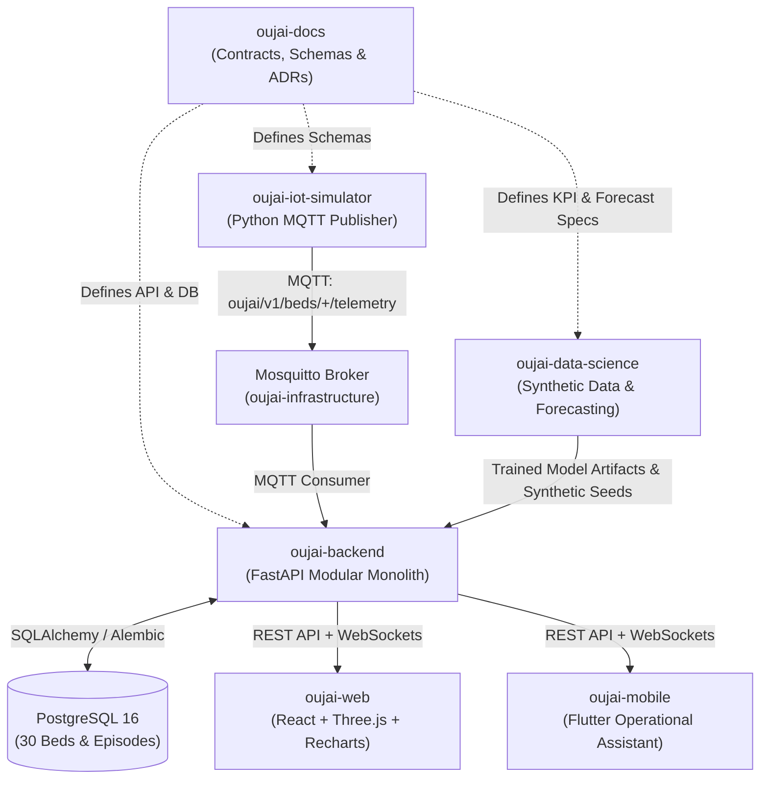

# OUJAI — Hospital Digital Twin

**OUJAI** is a bed-centric **Hospital Digital Twin** created as an 18-week undergraduate graduation project for Academic Year 2026–2027 by a four-student interdisciplinary team.

---

## Clinical & Operational Problem Statement

Hospital floors face critical operational bottlenecks when bed status updates are delayed, fragmented across phone calls and whiteboards, or disconnected from incoming patient flow. Staff struggle to distinguish between physical bed occupancy and operational readiness (such as cleaning, maintenance, or reservation windows), causing emergency boarding delays and inefficient ward turnarounds.

**OUJAI** creates a real-time, spatial, and predictive digital representation of a **30-bed hospital floor** across three departments:
- **Emergency Department (ER):** 10 beds (`ER-01` to `ER-10`)
- **Intensive Care Unit (ICU):** 8 beds (`ICU-01` to `ICU-08`)
- **General Ward (GW):** 12 beds (`GW-01` to `GW-12`)

> **Synthetic Data & Privacy Mandate:** All patient episodes, telemetry events, admissions, discharges, transfers, and occupancy histories in OUJAI are **100% synthetic**. No real patient records, personally identifiable information (PII), protected health information (PHI), real diagnoses, or clinical notes are permitted in any repository, database, or log.

---

## The Nine Official Features

1. **Real-Time Department Monitoring:** Live department-level telemetry and occupancy summaries across ER (10 beds), ICU (8 beds), and General Ward (12 beds).
2. **Bed Occupancy and Bed Board:** Authoritative tabular and card-based bed board distinguishing physical pressure-sensor signals from staff-managed operational states (`Available`, `Occupied`, `Reserved`, `Cleaning`, `Maintenance`).
3. **Interactive 3D Hospital Map with 2D Fallback:** Spatial floor visualization built with Three.js / React Three Fiber with an accessible 2D SVG floorplan fallback for low-power devices.
4. **Patient-Flow Visualization:** Tracking synthetic admissions, inter-department transfers (`ER → ICU`, `ICU → GW`, `ER → GW`), and discharges to expose transfer bottlenecks.
5. **Emergency Notifications:** Rule-driven operational alerts (e.g., ICU capacity threshold >85%, unacknowledged bed state discrepancy, prolonged cleaning turnaround).
6. **Operational Analytics:** Historical KPI dashboards including Bed Occupancy Rate (BOR), Average Length of Stay (ALOS), Bed Turnaround Time (BTT), and Admission-to-Bed Wait Time.
7. **AI Bed-Demand Forecast (24–72 Hours):** Department-level hourly and daily bed-demand forecasting comparing a trained ML/time-series model against a seasonal-naive baseline.
8. **Flutter Mobile Operational Assistant:** Role-tailored mobile workflows for nurses, bed managers, and doctors to inspect assigned beds, acknowledge alerts, and update bed readiness on the floor.
9. **Administration and Role-Based Access Control (RBAC):** JWT-secured authentication enforcing five distinct roles: `Admin`, `Bed Manager`, `Nurse`, `Doctor`, and optional read-only `Viewer`.

---

## Technology Stack

| Layer | Technologies | Architecture Constraint |
| :--- | :--- | :--- |
| **Backend** | Python 3.11+, FastAPI, SQLAlchemy 2.0, Alembic, Pydantic v2, PostgreSQL 16, JWT, REST APIs, WebSockets | **Modular Monolith** (No microservices, no Redis, no Firebase) |
| **Web Frontend** | React 18, TypeScript, Vite, Three.js / `@react-three/fiber`, Recharts | Single-Page Application consuming REST & WebSockets |
| **Mobile App** | Flutter 3.x, Dart | Cross-platform operational assistant consuming REST & WebSockets |
| **IoT & Telemetry** | MQTT (Eclipse Mosquitto 2.x), `paho-mqtt`, Python telemetry simulator, optional ESP32 pressure-sensor nodes | Publishes raw occupancy telemetry; never overwrites staff states directly |
| **Data Science & AI** | Python, `pandas`, `scikit-learn` / `Prophet`, `joblib`, Jupyter Notebook | Chronological splits, seasonal-naive baseline comparison, MAE/RMSE/MAPE |
| **Infrastructure & QA** | Docker, Docker Compose, GitHub Actions, `pytest`, Flutter test, optional Playwright | Reproducible local multi-container orchestration (No Kubernetes, no Unity) |

---

## Four-Student Team Structure

| Role ID | Specialization | Accountable Repositories | GitHub Handle |
| :--- | :--- | :--- | :--- |
| **Member 1 — IT** | Backend Architecture, DB/Migrations, RBAC, WebSockets, Docker & CI/CD | `.github`, `oujai-docs`, `oujai-backend`, `oujai-infrastructure` | `<GITHUB_USERNAME_IT>` |
| **Member 2 — DS-1** | Data Engineering, Synthetic Episodes, Schemas & IoT MQTT Simulator | `oujai-iot-simulator` | `<GITHUB_USERNAME_DS1>` |
| **Member 3 — DS-2** | AI & 24–72h Bed-Demand Forecasting, Model Evaluation & Export | `oujai-data-science` | `<GITHUB_USERNAME_DS2>` |
| **Member 4 — DS-3** | Operational Analytics, KPI Formulas, React Web & Flutter Mobile Visuals | `oujai-web`, `oujai-mobile` | `<GITHUB_USERNAME_DS3>` |

---

## Organization Repositories & Architecture

| Repository | Purpose & Scope | Primary Owner |
| :--- | :--- | :--- |
| [`.github`](https://github.com/oujai/.github) | Organization profile, community standards, issue/PR templates, and shared governance. | Member 1 (IT) |
| [`oujai-docs`](https://github.com/oujai/oujai-docs) | Central requirements, system architecture, Mermaid diagrams, OpenAPI/AsyncAPI/MQTT contracts, data dictionary, ADRs, and 18-week roadmap. | Member 1 (IT) |
| [`oujai-backend`](https://github.com/oujai/oujai-backend) | FastAPI modular monolith, PostgreSQL models, Alembic migrations, JWT RBAC, MQTT consumer, bed state machine, REST & WebSocket APIs. | Member 1 (IT) |
| [`oujai-web`](https://github.com/oujai/oujai-web) | React + TypeScript operational dashboard, bed board, 3D/2D hospital map, patient flow, alerts, KPI charts, and forecast view. | Member 4 (DS-3) |
| [`oujai-mobile`](https://github.com/oujai/oujai-mobile) | Flutter mobile assistant for bedside bed status transitions, alert acknowledgment, and quick ward lookup. | Member 4 (DS-3) |
| [`oujai-data-science`](https://github.com/oujai/oujai-data-science) | Synthetic dataset generators, data quality suites, KPI definitions, exploratory notebooks, and 24–72h bed-demand forecasting pipeline. | Member 3 (DS-2) |
| [`oujai-iot-simulator`](https://github.com/oujai/oujai-iot-simulator) | Python MQTT telemetry simulator generating synthetic 30-bed pressure sensor events and optional ESP32 firmware reference. | Member 2 (DS-1) |
| [`oujai-infrastructure`](https://github.com/oujai/oujai-infrastructure) | Docker Compose orchestration, Mosquitto broker configuration, environment templates, health checks, and end-to-end integration scripts. | Member 1 (IT) |

### How the Repositories Fit Together

